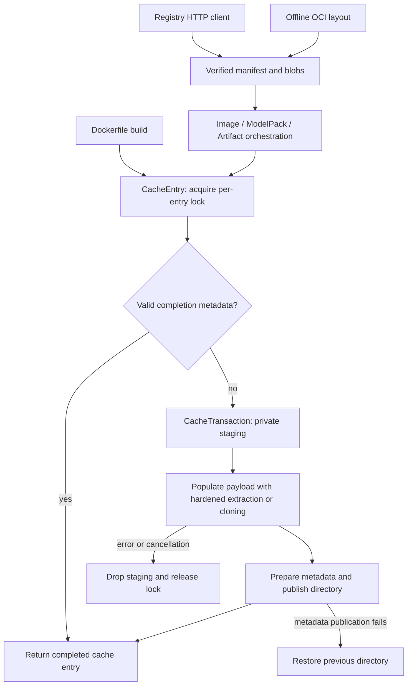

# Cache and OCI architecture

The cache lifecycle is shared by registry image pulls, offline OCI image loads,
Dockerfile build publication, ModelPack pulls, and generic artifact pulls. Public
CLI/SDK signatures and existing completed-cache paths and JSON formats are
preserved.

## Module boundaries

| Module | Responsibility |
| --- | --- |
| `oci/client.rs` | Registry HTTP, authentication, manifest selection, verified downloads |
| `oci/manifest.rs` | Transport-independent manifest structures and OCI configuration parsing |
| `oci/digest.rs` | SHA-256 syntax validation and content verification |
| `oci/cache.rs` | Cache paths, per-entry locks, private staging, completion metadata, publication and rollback |
| `rootfs/extract.rs` | Layer extraction, permissions and archive safety |
| `oci/layout.rs` | Offline image orchestration using the same image-cache lifecycle |
| `oci/artifact.rs`, `modelpack/engine.rs` | Domain-specific layer handling and metadata |
| `builder/executor.rs` | Build orchestration; final image publication delegates to the cache |

## Lifecycle and invariants

1. Validate the manifest digest before constructing paths. Cache kinds keep
   image, model, and artifact locks separate. Images retain the existing lock
   filename so upgraded image writers serialize with the old registry lock.
2. Acquire the lock before checking completion metadata. Synchronous offline
   loads use a blocking lock. Async pulls/build publication retry a nonblocking
   lock with Tokio timers, so contention does not block a runtime worker.
   Cancelling a waiter closes its descriptor and leaves no blocking background
   worker behind.
3. Only a directory with readable, valid completion metadata is a cache hit.
   Missing or malformed JSON is a miss; other I/O errors are surfaced. Model and
   artifact callers also compare the metadata digest with the requested manifest.
4. A transaction borrows its locked entry, keeping the lock alive through
   publication. Each transaction owns a unique temporary wrapper under `staging/`.
   The wrapper is private; its separate payload directory retains filesystem
   permissions appropriate for the published rootfs. Discovery only examines
   completed namespace directories and cannot list staged metadata.
5. Serialize metadata before replacing data. Model/artifact markers go inside
   staging. Image config remains in `configs/` for compatibility and is prepared
   in a sibling temporary file. Existing data is moved to a private backup before
   installation; an ordinary publication error restores it. Metadata writes use
   the hardened filename helper so a staged symlink cannot overwrite a host file.
6. Finish publication and remove the backup only after the completion marker
   succeeds. Dropping unfinished transactions removes their staging directories;
   blob files also use temporary-file publication instead of ad hoc names.

## Compatibility and scope

The image cache remains `rootfs/sha256_<hex>` plus `configs/sha256_<hex>.json`.
Models and artifacts retain `models/sha256_<hex>/.modelpack.json` and
`artifacts/sha256_<hex>/.krun_artifact.json`. No new dependency or cache migration
is required. Internal parser functions are no longer owned by the HTTP client.

Artifact hits now require valid, matching metadata rather than just the presence
of a marker file. Corrupt entries can be rebuilt. A failed blob-cache write is
reported instead of silently continuing.

This is an in-process error/cancellation and cooperative-locking design. It does
not provide a filesystem-wide power-loss transaction: SIGKILL or machine failure
can leave staging/backup directories. Image data and its external config cannot
be replaced with one filesystem rename. Acquisition paths participating in this
layer are serialized while that pair is published; direct filesystem readers
must not assume otherwise. Active guest mutation of cache/staging roots remains
unsupported.

Local Docker/Podman export ingestion, build-stage execution, and the local tag
registry retain their existing orchestration. They are not claimed to use this
transaction layer. Build-stage cleanup and tag-registry concurrency are separate
future work.

## Verification

The native libkrun Rust workspace passes 311 tests, including private staging,
permission preservation, ordinary-error rollback, serialization failures,
cancelled transactions and lock waiters, runtime progress during lock contention,
artifact discovery, offline extraction failure, digest checks, and existing
builder/model/serve integration coverage. Strict workspace Clippy and formatting
are checked alongside the tests. Validation ran on macOS ARM64; Linux execution
and crash/power-loss recovery are not established by this run.
