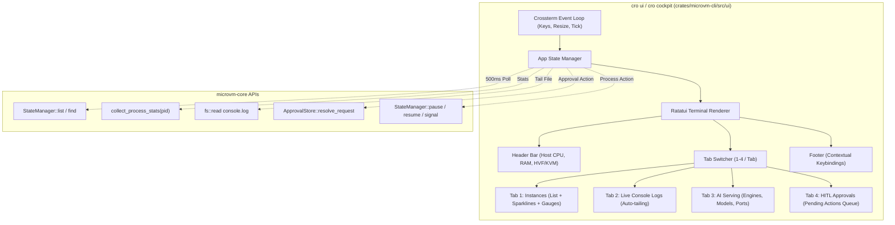

# Design Document: Interactive Multi-Tab Terminal Cockpit (`cro ui`)

**Status**: Approved Specification  
**Author**: Antigravity  
**Date**: 2026-11-04  
**Target Component**: `krun-microvm` (`crates/microvm-cli`, `crates/microvm-core`)  

---

## 1. Intent & Context

Managing microVMs, AI inference engines, and autonomous coding agent sandboxes currently requires running disparate CLI subcommands (`cro ps`, `cro stats`, `cro logs <id>`, `cro top`, `cro approval list`, `cro serve`). When debugging active microVMs or monitoring agent actions with Human-in-the-Loop (HITL) interception, developers need a unified, low-latency, real-time command cockpit.

`cro ui` (also callable via `cro cockpit` and `cro top -i`) introduces an interactive, multi-tab terminal dashboard powered by `ratatui` and `crossterm`. It gives developers a real-time visual monitor for hypervisor resources, live console logs, inference serving status, and instant HITL approvals from within any terminal or remote SSH session with zero browser dependencies.

---

## 2. Goals, Non-Goals, and Anti-Goals

### Goals
- **Multi-Tab Interface**: Provide 4 dedicated views navigable with `Tab` or number keys `1`-`4`:
  1. **Instances (Workstation)**: Split-pane table of microVMs with status badges, PID, vCPU/vRAM, and side-pane live CPU sparklines, memory progress gauges, and runtime metadata.
  2. **Live Logs**: Real-time auto-scrolling log stream from the selected microVM's `console.log`, with pause (`Space`), scrollback (arrows/PageUp), and search (`/`).
  3. **AI Serving**: Overview of running models, inference engines (`vllm`, `llamacpp`, `uzu`), exposed OpenAI-compatible HTTP endpoints, and memory footprint.
  4. **HITL Approvals**: Live queue of intercepted agent network requests and egress actions with one-key approval (`y`) or rejection (`n`).
- **Interactive Lifecycle Controls**: Trigger microVM actions (`p` Pause, `r` Resume, `s` Stop, `x` Force Kill, `d` Delete) directly on the highlighted instance.
- **Terminal Safety & Panic Hook**: Guarantee terminal cleanup (exit alternate screen, disable raw mode, show cursor) on clean exit or unexpected panics so the user's shell is never corrupted.
- **Zero-Allocation Smooth Rendering**: 30 FPS input responsiveness with 500ms background polling for process stats and file updates.

### Non-Goals
- Embedding an HTTP/WebSocket browser dashboard (strictly a native terminal application).
- Replacing standard CLI non-interactive scripting pipelines.

### Anti-Goals
- **Blocking the UI thread on I/O**: Heavy operations (reading large log files, killing processes, querying process tables) must never freeze keyboard navigation or UI redraws.

---

## 3. Constraints

- **Dependency Footprint**: Must use modern, secure crates with 0 vulnerabilities (`ratatui 0.30`, `crossterm 0.29`).
- **Platform Agnostic**: Must work identically on macOS (`Terminal.app`, `iTerm2`, `Alacritty`, `Ghostty`, `Kitty`) and Linux terminal emulators.
- **Clean Fallback**: Gracefully handle small terminal dimensions (minimum 80x24) with a helpful resize notice.

---

## 4. Approaches

### Approach 2A.1: Multi-Tab Full Terminal Cockpit (Selected)
- **Mechanism**: A modular Ratatui application divided into distinct view components (`Header`, `InstancesView`, `LogsView`, `ServeView`, `ApprovalsView`, `Footer`), connected via an asynchronous event loop listening to terminal input and background tick intervals.
- **Why Selected**: Provides a complete command center for both standard microVM workloads and AI agent sandboxes without requiring multiple terminal windows or browser tabs.

### Approach 2A.2: Single-Screen Compact Monitor (`htop`-style) (Discarded)
- **Mechanism**: An interactive upgrade to `cro top` displaying a single table and CPU/RAM summary.
- **Why Discarded**: Insufficient for agentic sandboxing workflows; cannot display streaming console logs, OpenAI inference engine endpoints, or HITL approval interception.

---

## 5. Architectural Specification & Module Design



### 5.1. Module Hierarchy (`crates/microvm-cli/src/ui/`)
- `mod.rs`: Terminal initialization, panic hook installation, event loop, and cleanup.
- `app.rs`: `App` state struct:
  - `current_tab: Tab` (Instances, Logs, Serve, Approvals)
  - `instances: Vec<VmDisplayItem>` with selected index
  - `cpu_history: HashMap<String, VecDeque<u64>>` for sparkline rendering
  - `log_buffer: Vec<String>` with scroll offset, tail-follow boolean, and search query
  - `approvals: Vec<ApprovalRequest>` with selected index
  - `notification: Option<(String, Instant)>` for brief status messages (e.g. "MicroVM vm-123 paused")
- `events.rs`: Non-blocking async event reader wrapping `crossterm::event::EventStream` and `tokio::time::interval(Duration::from_millis(250))`.
- `views/header.rs`: Top status bar displaying Host CPU count, RAM usage, Hypervisor mode (`Apple Silicon HVF` / `Linux KVM`), VM count summary (`Running`, `Paused`, `Stopped`).
- `views/instances.rs`:
  - Left table (60% width): `ID`, `PID`, `STATUS` (`● RUNNING` in green, `❚❚ PAUSED` in yellow, `○ STOPPED` in dark gray), `VCPUS`, `RAM`, `PORTS`.
  - Right panel (40% width): Selected instance detail: CPU sparkline widget, memory gauge widget, instance directory, and OCI image reference.
- `views/logs.rs`: Monospace console log viewer with auto-scroll down on new data, scrollback navigation, and line counter.
- `views/serve.rs`: Table of active model serving instances showing Model name, Engine (`vllm`, `llamacpp`, `uzu`), Port forward URL, and process status. Discovered via `<instance_dir>/serving.json` or `.krun_config.json` entrypoint command inspection.
- `views/approvals.rs`: Queue of pending HITL network and egress actions from `microvm_core::net::ApprovalStore` with destination host, port, payload snippet, and action hints (`[y] Approve`, `[n] Reject`).
- `views/footer.rs`: Keybinding bar showing active navigation keys (`[Tab]` Next Tab, `[↑/↓]` Navigate, `[p]` Pause, `[r]` Resume, `[s]` Stop, `[q]` Quit).

### 5.2. Terminal Cleanup & Panic Safety
```rust
pub fn setup_terminal() -> Result<Terminal<CrosstermBackend<Stdout>>> {
    enable_raw_mode()?;
    let mut stdout = std::io::stdout();
    execute!(stdout, EnterAlternateScreen, EnableMouseCapture)?;
    
    // Set panic hook to restore terminal if unexpected panic occurs
    let default_hook = std::panic::take_hook();
    std::panic::set_hook(Box::new(move |info| {
        let _ = disable_raw_mode();
        let _ = execute!(std::io::stdout(), LeaveAlternateScreen, DisableMouseCapture, Show);
        default_hook(info);
    }));

    let backend = CrosstermBackend::new(stdout);
    Terminal::new(backend).context("Failed to initialize terminal")
}

pub fn restore_terminal(terminal: &mut Terminal<CrosstermBackend<Stdout>>) -> Result<()> {
    disable_raw_mode()?;
    execute!(terminal.backend_mut(), LeaveAlternateScreen, DisableMouseCapture, Show)?;
    terminal.show_cursor()?;
    Ok(())
}
```

### 5.3. Process Lifecycle & State Semantics
- **Graceful Stop (`s`)**: Sends `SIGTERM` to the `microvm-runner` process. The instance transitions to `○ STOPPED`, leaving `console.log` and the instance directory intact for debugging and inspection.
- **Force Kill (`x`)**: Sends `SIGKILL` directly to the PID if unresponsive.
- **Delete (`d`)**: Explicitly purges the instance directory and state file from disk via `StateManager::remove`.

### 5.4. Keybinding Matrix

| Key | Context | Action |
| :--- | :--- | :--- |
| `Tab` / `BackTab` | Global | Cycle forward/backward through tabs |
| `1`, `2`, `3`, `4` | Global | Switch directly to Tab 1, 2, 3, or 4 |
| `q` / `Ctrl+C` | Global | Cleanly exit cockpit |
| `↑` / `k`, `↓` / `j` | Instances / Approvals | Select previous / next item |
| `p` | Instances | Pause selected microVM (`StateManager::pause`) |
| `r` | Instances | Resume selected microVM (`StateManager::resume`) |
| `s` | Instances | Gracefully stop selected microVM (`SIGTERM`) |
| `x` | Instances | Force kill microVM (`SIGKILL`) |
| `d` | Instances | Delete / prune stopped microVM files |
| `Enter` | Instances | Switch to Tab 2 and tail logs for selected microVM |
| `Space` | Logs | Toggle auto-tailing follow mode |
| `PageUp` / `PageDown` | Logs | Scroll log buffer up / down |
| `y` | Approvals | Approve pending agent request |
| `n` | Approvals | Reject pending agent request |

---

## 6. What Is Left to the Builder

- Styling themes and palette (Nord / Dracula / Tokyo Night compatible ANSI color schemes).
- Optimal initial log tail buffer size (default: 500 lines).
- CLI integration in `crates/microvm-cli/src/args.rs` and `commands/mod.rs`.
- Unit tests verifying `App` state transitions, tab switching, and selection clamping.
