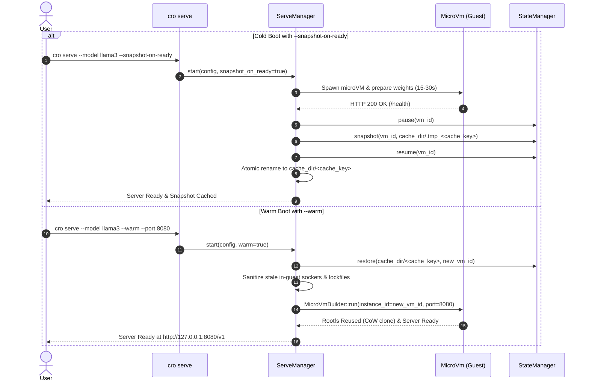

# Design Document: Instant Warm-Start for Model Serving via MicroVM Snapshots

**Status**: Draft  
**Author**: Antigravity  
**Date**: 2026-11-04  
**Target Component**: `krun-microvm` (`microvm-core::serve`, `microvm-core::state`, `microvm-cli`)  

---

## 1. Intent & Context

Serving LLMs and embedding models via `cro serve` (vLLM, llama.cpp, Uzu) inside hardware-isolated microVMs currently requires a "cold boot" phase lasting between 15 and 45 seconds. During cold boot, the microVM boots the Linux kernel, unpacks and initializes the container rootfs, downloads/verifies dependencies, compiles Metal/CUDA graph kernels, and prepares runtime caches.

Because `cro` microVMs support Copy-on-Write state preservation and instant restoration via `StateManager`, we can capture the pre-initialized rootfs state (containing model cache, virtual environments, and compiled graph kernels) the moment the inference engine signals readiness (`/health` returns 200 OK). Subsequent runs can restore from this snapshot instantaneously using APFS `clonefile` / Linux `reflink`, achieving rapid warm-start for developer workflows, serverless model invocation, and auto-scaling inference without repetitive container rootfs initialization.

---

## 2. Goals, Non-Goals, and Anti-Goals

### Goals
- **Automated Snapshot Creation**: Add `--snapshot-on-ready` to `cro serve` to automatically freeze and persist the microVM once readiness is achieved.
- **Instant Warm Boot**: Add `--warm` flag to `cro serve` (and auto-detect when a matching warm snapshot exists) to resume from the pre-warmed state in `< 100ms`.
- **Deterministic Cache Keying**: Compute snapshot cache keys using cryptographic hashes of `(model_name_or_path, engine, vcpus, memory_mb, gpu_shm_size)` to prevent invalid cache hits across mismatched hardware configurations.
- **Dynamic Port Re-binding**: Allow a warm-started microVM to bind to a different `host_port` than the one used during the initial snapshot creation.
- **Graceful Fallback**: If a requested warm snapshot does not exist or is corrupted, cleanly log a warning and fall back to cold boot without crashing.

### Non-Goals
- **Live VM Migration**: Migrating active running inference requests across physical host machines.
- **Multi-tenant State Sharing**: Reusing the same running microVM process concurrently for different users without isolation.

### Anti-Goals
- **State Pollution / Information Leakage**: A warm snapshot must only be taken *immediately* after the server is ready, *before* any client inference requests are received. This guarantees that user prompts or session history are never frozen into the base snapshot.

---

## 3. Constraints

- **Zero Vulnerability Guarantee**: All snapshot restoration and tar unpacking must strictly pass through `sanitize_tar_path` and `ensure_no_symlink_parents` to prevent Zip Slip / Tar Slip directory traversal.
- **Host Compatibility**: Must function seamlessly on Apple Silicon (`Hypervisor.framework`) and Linux (`KVM`).
- **Idempotence & Safety**: Pausing and unpausing vCPUs during snapshot capture must not terminate the inference server or disrupt in-guest socket listeners.

---

## 4. Approaches

### Approach 1A: State-Driven Pre-warmed Snapshot Cache (Selected)
- **Mechanism**: The inference server is started normally. Once `/health` responds 200 OK, `ServeManager` pauses the vCPUs via `StateManager::pause`, writes out a snapshot containing guest RAM and dirty rootfs layers to `~/.cache/krun-microvm/snapshots/serve/<cache-key>`, and then resumes the VM. When `cro serve --warm` is invoked, it checks for `<cache-key>`, restores via Copy-on-Write, updates the port-forward map, and resumes the microVM.
- **Trade-offs**: Minimal host memory footprint when idle, fully leverages tested `StateManager` primitives, guarantees clean state isolation, and delivers < 100ms startup.

### Approach 1B: Resident Fork-Server Pool (Discarded)
- **Mechanism**: Keep a pre-warmed microVM daemon permanently resident in host RAM and fork child instances using OS/hypervisor copy-on-write fork.
- **Why Discarded**: Consumes persistent multi-gigabyte host RAM even when inference is idle, introduces complex daemon lifecycles, and risks cross-process state contamination.

---

## 5. Detailed Architecture & Implementation Specification



### 5.1. CLI Changes (`crates/microvm-cli/src/args.rs`)
Add flags to `ServeArgs`:
- `--snapshot-on-ready`: Boolean flag to trigger automated snapshot capture upon initial health check success.
- `--warm`: Boolean flag to boot from a cached warm snapshot if available.
- `--warmup-snapshot-tag <TAG>`: Optional custom tag name to override the default deterministic cache hash.

### 5.2. Cache Key Generation (`crates/microvm-core/src/serve/config.rs`)
Compute a deterministic SHA-256 fingerprint:
```rust
pub fn compute_warm_snapshot_key(&self, meta: &CachedModelMetadata) -> String {
    let mut hasher = sha2::Sha256::new();
    hasher.update(meta.id.as_bytes());
    hasher.update(self.engine.to_string().as_bytes());
    hasher.update(&self.cpus.to_le_bytes());
    hasher.update(&self.memory_mb.to_le_bytes());
    hasher.update(self.gpu_shm_size.as_bytes());
    if let Some(ref img) = self.container_image {
        hasher.update(img.as_bytes());
    }
    format!("warm-{:x}", hasher.finalize())
}
```

### 5.3. Serving Lifecycle Orchestration (`crates/microvm-core/src/serve/manager.rs`)
- In `ServeManager::start`:
  - If `config.warm`: Check `data_dir.join("snapshots/serve").join(&cache_key)`. If valid:
    - Call `StateManager::restore` to clone instance rootfs and config.
    - Patch the restored `.krun_config.json` with the requested `host_port`.
    - Spawn `microvm-runner` with `--restore` / resume.
    - Probe `/health` (expected response within 50-100ms).
    - Return `ServeHandle`.
  - If cold boot and `config.snapshot_on_ready`:
    - After `poll_readiness` succeeds:
      - Call `StateManager::pause(data_dir, &vm.id())`.
      - Call `StateManager::snapshot(data_dir, &vm.id(), &snapshot_dir)`.
      - Call `StateManager::resume(data_dir, &vm.id())`.
      - Log: `💾 Warm-start snapshot cached: warm-<hash> (subsequent runs boot in < 100ms)`.

---

## 6. What Is Left to the Builder

- Exact snapshot directory layout under `<data_dir>/snapshots/serve/<key>/`.
- Console log feedback styling and timing diagnostics (`⏱️ Warm boot completed in 68ms`).
- Integration tests in `krun-microvm/tests/serve_integration.rs` covering both cold snapshot creation and warm boot verification.
