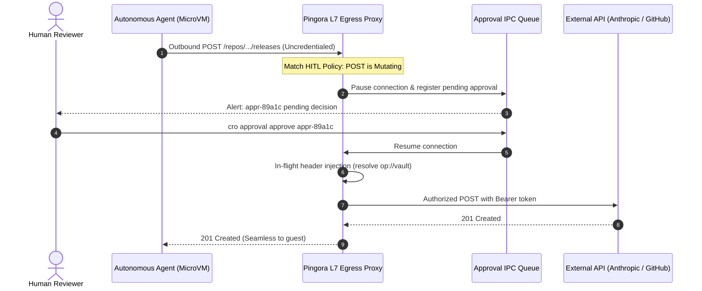
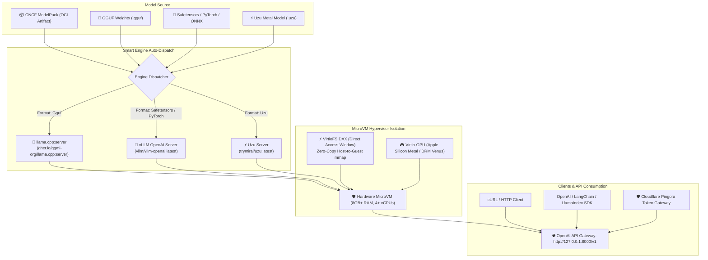
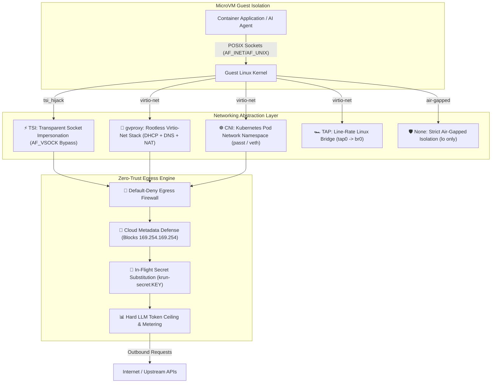

> Security and compatibility notes: [hardening report](../docs/SECURITY-HARDENING.md). The document UI is a simulation; hardware detonation is not implemented.

<div align="center">


# ⚡ CroSandbox (`cro`)

### The Premier Pure-Rust MicroVM Virtualization & Orchestration Platform
<p><b>ISOLATE &bull; EXECUTE &bull; CONTROL</b></p>

[](LICENSE)
[%20%7C%20Linux%20(KVM)-black.svg?style=for-the-badge&logo=apple)](https://github.com/CroSandbox/cro)
[](https://www.rust-lang.org)
[](https://github.com/CroSandbox/cro)
[](https://github.com/CroSandbox/cro)
[](examples/krun-compose.yaml)

<p align="center">
  <b>Run standard OCI container images and AI workloads inside hardware-isolated microVMs.</b><br>
  Sub-100ms cold boot times • Apple Silicon Metal & Linux DRM Venus GPU acceleration • Native Docker Compose orchestration • Zero-trust AI agent sandboxing • Zero CGO & zero runtime overhead.
</p>

[Quickstart](#-quickstart-in-30-seconds) • [Why CRO?](#-why-cro) • [Compose & YAML](#-declarative-compose--yaml) • [Architecture](#-architectural-dominance-cro-vs-alternatives) • [AI Sandboxing & HITL](#-ai-agent-sandboxing--gpu) • [Zero-Trust Networking](#-advanced-microvm-networking--zero-trust-security) • [Kubernetes](#-kubernetes--containerd-integration) • [Commands](#-complete-cli-command-reference) • [Prerequisites & Submodules](#-prerequisites--submodules) • [SDKs](#-multi-language-client-sdks)

---

</div>

## 🌟 Overview

**cro** is a modern, high-performance virtualization SDK and microVM orchestration suite powered by [`libkrun`](https://github.com/libkrun/libkrun). Built from the ground up in memory-safe Rust, it transforms ordinary OCI container images (from Docker Hub, GHCR, or local registries) into hardware-isolated virtual machines in **under 100 milliseconds**.

Whether you are building **AI coding agent sandboxes** (Claude, Gemini, Codex), running **multi-container microVM stacks with Docker Compose**, deploying **isolated serverless functions**, or orchestrating **Kubernetes Pods with hardware virtualization boundaries**, `cro` delivers true hypervisor isolation with native developer ergonomics. Both `cro` and `microvm` CLI commands are supported interchangeably.

---

## 🏛️ Elephant-Goldfish Architectural Blueprint

### System Overview
`cro` is structured as a decoupled workspace separating low-level hypervisor primitives, core orchestration and state management, high-level CLI interfaces, and container ecosystem runtimes (containerd/Kubernetes). Each crate maintains explicit boundaries, invariants, and side effects documented in its contract README.

### Subdirectories & System Boundaries
- [`crates/microvm-core`](./crates/microvm-core/README.md): Core orchestration, state persistence, image building, AI model serving, and zero-trust proxying.
- [`crates/microvm-cli`](./crates/microvm-cli/README.md): Unified CLI front-end (`cro` / `microvm`) and full-screen terminal UI Cockpit.
- [`crates/microvm-runner`](./crates/microvm-runner/README.md): Dedicated hypervisor supervisor process managing individual VM contexts and IPC sockets.
- [`crates/containerd-shim-krun`](./crates/containerd-shim-krun/README.md): Containerd CRI v2 runtime shim for Kubernetes microVM execution.
- [`crates/krun-operator`](./crates/krun-operator/README.md): Kubernetes CRD controller managing declarative `krun.io/v1alpha1 MicroVm` custom resources.
- [`crates/krun-sys`](./crates/krun-sys/README.md): Safe/unsafe Rust FFI bindings to the `libkrun` C virtualization engine.
- [`crates/libgvproxy-sys`](./crates/libgvproxy-sys/README.md): Rust FFI bindings to user-mode `libgvproxy` networking.
- [`sdks/python`](./sdks/python/README.md): Python Client SDK for programmatic microVM orchestration.
- [`sdks/typescript`](./sdks/typescript/README.md): TypeScript/Node.js Client SDK.
- [`sdks/go`](./sdks/go/README.md): Go Client SDK.
- [`sdks/elixir`](./sdks/elixir/README.md): Elixir Client SDK.

### Global Invariants
- **Hardware Isolation Boundary**: Every running guest container executes inside an isolated hypervisor virtual machine (`Hypervisor.framework` on macOS, KVM on Linux) with separate page tables, kernel, and memory allocations.
- **Archive Traversal Immunity**: All image extractions, file mounts, and snapshot archives must strictly enforce `sanitize_tar_path` and `ensure_no_symlink_parents` to prevent host file traversal.
- **Fail-Safe VM Pausing**: Any lifecycle operation pausing guest vCPUs (such as snapshot capture) must guarantee process resumption on both error and success paths.
- **Deterministic Serving Keying**: Warm-start snapshot fingerprints incorporate model digest, engine type, hardware allocation, GPU limits, and runtime arguments to guarantee that restored instances exactly match requested execution constraints.

### Global Side Effects
- **Local State Storage**: Persists microVM instances, cached layers, and snapshots under `~/.cache/krun-microvm/` (overridable via `--data-dir`).
- **Host Network Forwarding**: Spawns user-space proxies and binds requested host TCP ports for guest communication.
- **Kernel Virtualization**: Creates hardware hypervisor VM instances on the host system.

### System Verification
- Workspace Unit & Integration Tests: `cargo test --workspace`
- Clippy Linter: `cargo clippy --all-targets -- -D warnings`
- Code Formatter: `cargo fmt --all -- --check`
- Security Audit: `cargo audit`

---

## ⚡ Quickstart in 30 Seconds

### 1. One-Line Installation
```bash
# Automated installer for macOS (Apple Silicon) and Linux:
./install.sh
```

### 2. Run Any OCI Container in a MicroVM
```bash
# Boots a hardware-isolated Linux microVM in <100ms:
cro run alpine:latest -- echo "🚀 Hello from cro microVM!"

# Check guest Linux kernel (running isolated on macOS Apple Silicon or Linux KVM):
cro run alpine:latest -- uname -a
# Linux localhost 6.12.109 #1 SMP aarch64 Linux (libkrunfw v5.6.2)
```

### 3. Deploy Multi-Service Stacks with Docker Compose
```bash
# Start multi-microVM stack (Redis + Web proxy) in background:
cro compose up -f examples/krun-compose.yaml -d

# Check live microVM status and port forwards:
cro compose ps -f examples/krun-compose.yaml

# Stream aggregated service logs:
cro compose logs -f

# Gracefully stop and clean up:
cro compose down -f examples/krun-compose.yaml
```

### 4. Launch an Isolated AI Coding Agent Sandbox with Git Cherry-Pick & HITL Gateway
```bash
# Isolated workspace with copy-on-write filesystem, git cherry-pick, and auto-sync:
cro sandbox claude \
    --workspace . \
    --cherry-pick 7f4a2b1 \
    --apply-to-host \
    --secret ANTHROPIC_API_KEY=env:ANTHROPIC_API_KEY

# Or launch with Human-in-the-Loop (HITL) approval gateway and dynamic 1Password vault injection:
cro sandbox dev \
    --hitl \
    --secret "ANTHROPIC_API_KEY=op://ai-vault/anthropic-key" \
    --allow-host api.anthropic.com:443 \
    -- python agent.py
```

### 5. Build Container Images In-Process (No Docker Daemon Required)
```bash
# Build an OCI rootfs directly from a Dockerfile using the native in-process engine:
cro build -t my-microservice:1.0 -f Dockerfile .

# Instantly run your newly built image with hardware microVM isolation:
cro run -p 8080:8080 my-microservice:1.0
```

### 6. Run Production Kubernetes Pods with MicroVM Hardware Isolation (`cro kube play`)
```bash
# Launch all containers in a standard Kubernetes Pod manifest (sharing network and volumes):
cro kube play pod.yaml -d

# Gracefully stop and tear down the Pod:
cro kube down pod.yaml
```

### 7. Launch the Unstructured Document Intake & AI Threat Shield (`/unstructured`)
```bash
# Start the Elixir OTP server with Web UI and REST API:
cd krun-microvm/sdks/elixir && PORT=4005 mix run --no-halt

# Open the Web UI:
open http://localhost:4005/unstructured
```

### 8. Package & Run AI Models via CNCF ModelPack (`cro model` & `cro run --model`)
```bash
# Package local model weights (GGUF, Safetensors, ONNX) into a CNCF ModelPack OCI layout:
cro model pack -s ./models/llama3 -o ./llama3-modelpack -n llama-3.2-1b -f gguf -a llama -p q4_k_m

# Inspect model architecture, layers, precision, and context length:
cro model info ./llama3-modelpack

# Pull and cache an AI ModelPack artifact from any standard OCI container registry:
cro model pull ghcr.io/org/llama-3.2-1b:latest

# Run an inference container with zero-copy VirtioFS DAX shared memory mapping:
cro run --model ghcr.io/org/llama-3.2-1b:latest:/models/llm alpine:latest -- ls -lh /models/llm
```

### 9. Serve Models with Smart Auto-Dispatch & OpenAI API (`cro serve` / `cro vllm`)
```bash
# Serve any cached ModelPack, local model directory, or GGUF/Safetensors file:
cro serve llama-3.2-1b -d

# Send an OpenAI-compatible chat completion request:
curl http://127.0.0.1:8000/v1/chat/completions \
    -H "Content-Type: application/json" \
    -d '{
        "model": "llama-3.2-1b",
        "messages": [{"role": "user", "content": "Explain microVM VirtioFS DAX in one sentence."}]
    }'

# Or launch with strict vLLM engine, 16 GB RAM, and 8 vCPUs:
cro vllm serve mistralai/Mistral-7B-v0.1 --engine vllm -m 16384 -c 8
```

### 10. Apple Silicon Rosetta 2 for Linux (`--rosetta` / `--platform linux/amd64`)
```bash
# Run x86_64 / amd64 Linux containers seamlessly on Apple Silicon via VirtioFS + binfmt_misc:
cro run --rosetta --platform linux/amd64 alpine:latest -- uname -m
# x86_64
```

### 11. Automatic Local Domain Ingress Router (`*.cro.local`)
```bash
# Start background loopback reverse router:
cro domain start -d

# Running microVMs and Compose services are automatically accessible:
# http://<name>.cro.local or http://<service>.<project>.cro.local
curl http://llama.cro.local:8080/v1/models

# Inspect active domain mappings:
cro domain list
```

### 12. Persistent Linux Developer Workstations (`cro machine`)
```bash
# Create an instant persistent workstation (Ubuntu, Debian, Fedora, Alpine, Arch, Rocky):
cro machine create dev --distro ubuntu -c 4 -m 4096

# Open an interactive login shell with host $(USER) and /Users path parity:
cro machine shell dev

# Run one-off commands inside the machine:
cro machine shell dev -- uname -a

# Manage persistent workstations:
cro machine list
cro machine stop dev
cro machine start dev
```

---

## 🚀 Why CRO?

<table>
<tr>
<td width="33%" valign="top">

### ⚡ Sub-100ms Cold Boots
Direct PID 1 static execution (`init.krun`) and instant APFS `clonefile` / Linux `FICLONE` Copy-on-Write rootfs snapshotting. No guest VM image building, no cloud image bloat.

</td>
<td width="33%" valign="top">

### 🛡️ True Hardware Isolation
Hardware virtualization boundary powered by Apple Silicon's `Hypervisor.framework` on macOS and `/dev/kvm` on Linux. Protection against kernel exploits, container escapes, and host tampering.

</td>
<td width="33%" valign="top">

### 🐳 Declarative Compose & CRDs
Drop-in compatibility with **Docker Compose** (`krun-compose.yaml`) and **Kubernetes MicroVm CRDs** (`krun.io/v1alpha1`). Topological dependency resolution with cycle detection.

</td>
</tr>
<tr>
<td width="33%" valign="top">

### 🏎️ GPU Passthrough & DAX
Hardware-accelerated virtio-gpu (Apple Silicon Metal & Linux DRM Venus). Native **VirtioFS DAX window** for zero-copy memory-mapped LLM weights (GGUF, Safetensors).

</td>
<td width="33%" valign="top">

### 🔒 Zero-Trust AI Sandboxing & HITL
Automated agent sandboxes with egress domain allowlists (blocks AWS metadata SSRF `169.254.169.254`), Human-in-the-Loop approval wire-hold, in-flight secret substitution, and streaming LLM token budget meters.

</td>
<td width="33%" valign="top">

### ☸️ Native Kubernetes CRI
Official containerd v2 TTRPC shim (`containerd-shim-krun-v2`) and pure-Rust `kube-rs` Operator. Run isolated Pods alongside runc containers with `runtimeClassName: krun`.

</td>
</tr>
</table>

---

## 📊 Architectural Dominance: CRO vs. Alternatives

| Capability | Legacy Docker / runc | AWS Firecracker | Legacy Kata Containers (QEMU) | **`cro` (Pure Rust)** |
|---|:---:|:---:|:---:|:---:|
| **Isolation Boundary** | OS Namespaces / cgroups | Hardware MicroVM (KVM) | Heavy VM (QEMU) | **Hardware MicroVM (`libkrun`)** |
| **Apple Silicon (macOS) Support** | ❌ (requires Linux VM) | ❌ (Linux KVM only) | ❌ (Linux only) | **✅ Native (`Hypervisor.framework`)** |
| **Linux KVM Support** | ✅ | ✅ | ✅ | **✅ Native (`/dev/kvm`)** |
| **Cold Boot Latency** | ~300ms – 1s | ~250ms – 600ms | ~1500ms – 3000ms | **⚡ Sub-100ms (`<90ms`)** |
| **Hypervisor Memory Overhead** | ~30 MB – 50 MB | ~50 MB – 80 MB | ~120 MB – 250 MB | **⚡ < 15 MB razor-thin** |
| **Docker Compose Orchestration** | ✅ (Standard) | ❌ (External tooling) | ❌ | **✅ Native (`cro compose`)** |
| **GPU / Metal Passthrough** | ❌ (Emulated/None on Mac) | ❌ | Complex VFIO | **✅ Native Metal & DRM Venus** |
| **VirtioFS DAX (LLM Weights)** | ❌ | ❌ | Complex block setup | **✅ Zero-Copy Shared Memory Window** |
| **Zero-Trust Egress & Secret Proxy** | ❌ | ❌ (Manual iptables) | ❌ | **✅ Built-in Host Security Proxy** |
| **Direct OCI Execution** | ✅ | ❌ (Requires raw rootfs) | ✅ | **✅ Direct OCI Image & Registry Pull** |
| **Disk Image Formats** | Raw overlay | Raw only | QEMU formats | **✅ RAW, QCOW2 & VMDK (macOS Relaxed Sync)** |
| **Orderly Shutdown Signaling** | SIGTERM to PID 1 | Serial / API | ACPI | **✅ ACPI / GPIO EventFd Interrupt** |
| **In-Memory FS Overlays** | ❌ (Requires temp files) | ❌ | ❌ | **✅ Zero-Disk Virtual Injections (`one_shot`)** |

---

## 🐳 Declarative Compose & YAML

`cro` provides first-class support for multi-container microVM orchestration via Docker Compose YAML and Kubernetes CRD manifests.

### 1. Multi-Service MicroVM Spec (`krun-compose.yaml`)
Define your entire multi-microVM topology with dependencies, CPU/RAM allocations, VirtioFS host mounts, port forwards, and environment variables:

```yaml
version: "3.8"
name: demo-stack

services:
  # Isolated Redis Cache MicroVM
  redis:
    image: redis:alpine
    cpus: 1
    memory: 256M
    ports:
      - "6379:6379"
    volumes:
      - "./redis-data:/data"
    command: ["redis-server", "--appendonly", "yes"]

  # Isolated Web Proxy MicroVM
  web:
    image: nginx:alpine
    cpus: 2
    memory: 512M
    depends_on:
      - redis
    ports:
      - "18080:80"
    environment:
      APP_ENV: production
      CACHE_HOST: 127.0.0.1
    volumes:
      - "./html:/usr/share/nginx/html:ro"
```

### 2. Compose CLI Commands
```bash
# Start all microVM services in topological order (redis first, then web):
cro compose up -d

# Check status of running microVM services:
cro compose ps

# Follow aggregated logs across all microVMs with service prefixes:
cro compose logs -f

# Validate and inspect resolved configuration:
cro compose config

# Stop running services without removing container state:
cro compose stop

# Start previously stopped services:
cro compose start

# Restart microVM services:
cro compose restart

# Stop and gracefully clean up all microVM instances, networks, and volumes:
cro compose down -v
```

### 3. Kubernetes Declarative MicroVm CRD (`cro apply`)
Deploy single-microVM declarative manifests matching Kubernetes `krun.io/v1alpha1` CRD format:

```yaml
apiVersion: krun.io/v1alpha1
kind: MicroVm
metadata:
  name: alpine-agent
spec:
  image: alpine:latest
  vcpus: 2
  memory: 512M
  port: 18080
  networkMode: tsi
  workspaceCow: "./workspace:workspace"
  sandbox: true
  allowEgress:
    - "*.github.com:443"
    - "api.openai.com:443"
  cmd:
    - "/bin/sh"
    - "-c"
    - "echo '🚀 Running inside hardware-isolated microVM!' && sleep 1"
```

```bash
# Apply manifest directly with one command:
cro apply -f examples/microvm.yaml -d

# Or execute with microvm run:
cro run -f examples/microvm.yaml -d
```

### 4. Local Kubernetes Pod Parity (`cro kube play` & `cro kube down`)

Run standard, production-grade Kubernetes `v1/Pod` YAML definitions directly on your workstation with hardware microVM isolation—**without running Minikube, Kind, or a heavy local Kubernetes cluster**:

```yaml
# pod.yaml
apiVersion: v1
kind: Pod
metadata:
  name: fullstack-pod
  labels:
    app: fullstack
spec:
  restartPolicy: Always
  volumes:
    - name: app-data
      hostPath:
        path: /tmp/cro-data
  containers:
    - name: backend
      image: node:20-alpine
      command: ["node"]
      args: ["server.js"]
      ports:
        - containerPort: 3000
          hostPort: 3000
      env:
        - name: NODE_ENV
          value: production
      resources:
        limits:
          cpu: "2"
          memory: "1024Mi"
      volumeMounts:
        - name: app-data
          mountPath: /data
      shmSize: "256m"

    - name: frontend
      image: nginx:alpine
      ports:
        - containerPort: 80
          hostPort: 8080
```

```bash
# 🚀 Launch the entire Pod (all containers booted in topological order sharing network):
cro kube play pod.yaml -d

# 📊 Check live status of Pod containers:
cro compose ps

# 🛑 Gracefully terminate and clean up all Pod microVMs:
cro kube down pod.yaml
```

- **Zero-Cluster Overhead**: No kubelet, no etcd, no control plane overhead. Each container runs as an isolated microVM with shared inter-service networking and hostPath volumes.
- **Spec Fidelity**: Honors `command` (entrypoint), `args` (cmd), `ports` (`containerPort` & `hostPort`), resource requests/limits (`cpu` & `memory`), `env`, `shmSize`, and `volumeMounts`.

---

### 5. Native In-Process Dockerfile Builder (`cro build`)

Build container images locally from standard `Dockerfile` definitions without needing Docker Desktop, Podman, or any background container engine:

```dockerfile
# Dockerfile
FROM alpine:3.19 AS builder
WORKDIR /build
COPY . .
RUN echo "Compiling application assets..."

FROM alpine:3.19
WORKDIR /app
COPY --from=builder /build/app.sh /app/app.sh
ENV PORT=8080
EXPOSE 8080
CMD ["/app/app.sh"]
```

```bash
# 🔨 Build and tag an OCI image directly into the local microVM cache:
cro build -t myapp:latest -f Dockerfile .

# 🚀 Immediately launch your built image inside a microVM:
cro run -p 8080:8080 myapp:latest
```

- **In-Process Engine**: Zero background daemons. Parses Dockerfiles, runs intermediate steps inside hardware-isolated guest sandboxes, and commits the resulting rootfs using instant APFS `clonefile` / Linux `FICLONE`.
- **Full Directive Support**: Supports `FROM ... AS` (multi-stage builds), `WORKDIR`, `ENV`, `COPY` (with `--from=<stage>`), `ADD`, `RUN`, `CMD`, `ENTRYPOINT`, `EXPOSE`, `USER`, and `LABEL`.
- **Smart `.dockerignore`**: Automatically filters build contexts respecting standard ignore patterns, wildcards (`**`), and negation (`!`).
- **Immediate Local Execution**: Locally built images are indexed in `local_images.json` and immediately available to `cro run` without hitting any remote registry.

---

## 🤖 AI Agent Sandboxing & GPU

### 1. Zero-Trust Coding Agent Sandboxes
Safely execute autonomous coding agents (Claude, Gemini, Codex, Dev) without exposing your host machine or sensitive credentials:

```bash
# Run an autonomous coding sandbox with Copy-on-Write host mount:
cro sandbox claude \
    --workspace /path/to/my-repo \
    --secret ANTHROPIC_API_KEY=env:ANTHROPIC_API_KEY \
    --cpus 4 \
    --memory 2048
```

- **Isolated Copy-on-Write (CoW)**: Agent modifications remain isolated in temporary CoW storage; your host directory is untouched until committed.
- **In-Flight Secret Substitution**: Injected API keys are replaced by the host proxy in-flight (`krun-secret:ANTHROPIC_API_KEY`); the guest VM never holds the raw credential in RAM.
- **LLM Token Ceilings**: Enforce hard token budgets with `--max-tokens 50000` to prevent runaway API spend.

### 2. Human-in-the-Loop (HITL) Gateway & Dynamic Vault Injection (OneCLI Architecture)
Drawing directly from zero-trust agent security paradigms (such as [OneCLI](https://github.com/onecli/onecli)), `cro` features an advanced **Human-in-the-Loop (HITL) Gateway** integrated directly into the Cloudflare Pingora L7 proxy:

```bash
# Launch an agent sandbox with HITL approval and external vault secret resolution:
cro sandbox \
    --hitl \
    --secret "ANTHROPIC_API_KEY=op://ai-vault/anthropic-key" \
    --secret "GITHUB_TOKEN=bw://tokens/github-pat" \
    --allow-host api.anthropic.com:443 \
    --allow-host api.github.com:443 \
    -- python agent.py
```



- **Zero Credentials in MicroVM**: API keys and tokens are **never** passed into container environment variables, filesystem configs, or RAM. The guest agent issues requests uncredentialed or with placeholder headers; Pingora resolves the real secret dynamically from 1Password (`op://`), Bitwarden (`bw://`), environment variables (`env:`), or secure files (`file:`) and injects it on the wire.
- **Mutating Request Hold**: Any outbound request attempting state mutations (`POST`, `PUT`, `DELETE`, `PATCH`, destructive endpoints) is suspended in-flight at the L7 proxy.
- **Cross-Process IPC Approval Queue**: Review and unblock paused connections from another terminal tab or automation script:
  ```bash
  # View all outbound requests currently held on the wire:
  cro approval list

  # Approve and resume the request:
  cro approval approve appr-89a1c

  # Or deny with HTTP 403 Forbidden sent to the agent:
  cro approval deny appr-89a1c --reason "Unsanitized release deletion attempt"
  ```
- **Realtime WebUI Approvals Dashboard**: Visual cards with payload previews, automated threat summarization, and one-click approve/deny controls in the `/unstructured` WebUI.

### 3. Isolated Git Cherry-Pick & Bi-Directional Commit Syncing
Test feature branches or pull requests inside a safe microVM without altering your local working directory:

```bash
# 🍒 1. Cherry-pick a remote or feature commit directly into the isolated sandbox:
cro sandbox dev \
    --workspace . \
    --cherry-pick 3a7b9c1 \
    --apply-to-host

# 🍒 2. Auto-forward host Git identity & bypass container 'dubious ownership' issues:
# The microVM automatically injects your host git author credentials and enables safe.directory

# 🍒 3. Cherry-pick commits back to host on demand from any historical sandbox:
cro cherry-pick <microvm-id> -w .
```

- **In-Guest Cherry-Pick**: Pulls and cherry-picks target commit inside the isolated container before launching the agent or interactive shell.
- **Automatic Host Application (`--apply-to-host`)**: Detects new git commits made by the AI agent in the CoW workspace and cleanly applies them via `git am --3way` upon exit.
- **Zero Risk**: If the cherry-pick conflicts or the agent breaks the codebase, your host files and git history remain pristine.

### 4. Hardware-Accelerated Local LLM Inference
Leverage Apple Silicon Metal or Linux DRM Venus GPU passthrough:

```bash
# Boot mistral.rs inside an isolated microVM with Apple Silicon Metal acceleration:
cro run \
    --gpu --gpu-shm-size 4G \
    --dax 4G \
    -p 1234:1234 \
    ghcr.io/ericlbuehler/mistral.rs:latest
```

### 5. High-Performance AI POSIX Shared Memory (`--shm-size` & `/dev/shm`)

High-performance AI/ML workflows (PyTorch multi-process `DataLoader(num_workers > 0)`, Hugging Face Transformers) and headless Chromium (Playwright / Puppeteer) require dedicated POSIX shared memory. Without it, PyTorch crashes with `RuntimeError: unable to write to /dev/shm`.

`cro` mounts a dedicated `tmpfs` at `/dev/shm` with `mode=1777`:

```bash
# Allocate 2GB of high-speed POSIX shared memory for PyTorch training:
cro run \
    --shm-size 2g \
    --gpu \
    --gpu-shm-size 4G \
    pytorch/pytorch:latest -- python train.py

# Or run headless browser automation without shared memory crashes:
cro run --shm-size 512m mcr.microsoft.com/playwright:v1.45.0
```

- **Dual-Layer Hardened Sticky Bits**: Guarantees `/tmp`, `/var/tmp`, and `/dev/shm` maintain world-writable sticky bit permissions (`0o1777`) across both host layer unpacking and guest PID 1 initialization, completely eliminating unprivileged permission traps (`_apt`, `postgres`, `nginx`).

---

### 6. Multi-Format Block Storage (RAW, QCOW2, VMDK) & VirtioFS DAX

Powered by `libkrun v2` extensions, `cro` provides native enterprise block device virtualization and high-throughput shared memory windows:

```bash
# 💽 Attach high-capacity QCOW2 or VMDK virtual disks with parallel reads & macOS relaxed sync:
cro run \
    --disk ./database.qcow2 \
    --disk backup:./backup.vmdk:ro \
    --disk-parallel-reads \
    --disk-read-pool-size 16 \
    --dax 4G \
    --fs-cache always \
    --fs-permissions complete \
    --balloon-reporting replace \
    ubuntu:24.04

# ⚡ Instant on-demand container streaming with Dragonfly Nydus RAFSv6:
cro run \
    --lazy-load \
    --nydus-bootstrap /var/lib/nydus/bootstrap.rafs \
    --nydus-cache /var/cache/nydus \
    alpine:latest
```

- **Universal Multi-Format Block Devices**: Full native support for raw disk images, QCOW2 (QEMU Copy-on-Write v2/v3), and VMDK (VMware Virtual Machine Disk). `cro` automatically identifies the format by file extension and magic headers.
- **Concurrent Block Device Reads**: `--disk-parallel-reads` with configurable worker pool size (`--disk-read-pool-size <N>`) services concurrent guest I/O requests simultaneously without head-of-line blocking.
- **macOS Relaxed Disk Syncing (`F_BARRIERFSYNC`)**: Default block device mode utilizes relaxed barrier syncing (`DiskSyncMode::Relaxed`) on Apple Silicon APFS to avoid disk flush bottlenecks while preserving metadata consistency.
- **VirtioFS Cache & Permission Semantics**: Fine-grained host filesystem caching via `--fs-cache <never|auto|always>` and POSIX permission compliance control via `--fs-permissions <complete|simplified>`.
- **macOS Memory Balloon Host Reclamation**: `--balloon-reporting replace` dynamically returns guest freed memory pages directly back to the macOS host Virtual Memory subsystem via `mach_vm_deallocate` / `madvise`.
- **Orderly ACPI/GPIO EventFd Shutdown**: Clean eventfd-based poweroff interrupts allow guest kernels to gracefully sync file systems and unmount before hypervisor termination.
- **VirtioFS DAX Zero-Copy Window**: Direct access memory mapping (`--dax <size>`) maps LLM weights (GGUF, Safetensors) directly into the guest address space with zero memory duplication.
- **In-Memory File Overlays**: Seamless zero-disk injection of system configuration files (`/etc/hosts`, `/etc/resolv.conf`, network credentials) via `one_shot` virtual entries.

---

## 📦 CNCF ModelPack Specification (`cro model`)

`cro` natively adopts the **[CNCF ModelPack Specification](https://github.com/modelpack/model-spec)** (`modelpack/model-spec`), establishing vendor-neutral packaging, distribution, and zero-copy hypervisor execution for AI/ML models.

### Key Capabilities

1. **Vendor-Neutral OCI Distribution**:
   AI models (weights, tokenizers, architecture descriptors, model cards) are packaged into standard OCI artifacts and stored directly in your container registry (GHCR, Docker Hub, Quay, Harbor) with dedicated media types:
   - **Manifest**: `application/vnd.cncf.model.manifest.v1+json`
   - **Config**: `application/vnd.cncf.model.config.v1+json`
   - **Weight Layer**: `application/vnd.cncf.model.weight.v1.tar`
   - **Config Layer**: `application/vnd.cncf.model.weight.config.v1.tar`
   - **Tokenizer Layer**: `application/vnd.cncf.model.tokenizer.v1.tar`
   - **Documentation**: `application/vnd.cncf.model.doc.v1.tar`

2. **Zero-Copy VirtioFS DAX Execution**:
   When launching a microVM with `--model <ref>[:<mount_path>]`, `cro` automatically inspects the model format (GGUF, Safetensors, ONNX) and provisions an appropriately sized **VirtioFS DAX (Direct Access) shared memory window**. Weights are directly `mmap`'d into the guest virtual address space without double-buffering or memory duplication.

3. **Automatic Guest Environment Injection**:
   Every attached ModelPack automatically injects guest runtime environment variables into `/.krun_config.json`:
   - `MODEL_NAME`: Identifier of the model (e.g. `llama-3.2-1b-instruct`)
   - `MODEL_PATH`: Guest mount point (default: `/models/<name>` or custom)
   - `MODEL_FORMAT`: Weight serialization format (`gguf`, `safetensors`, `onnx`, `pytorch`)
   - `MODEL_ARCHITECTURE`: Base neural network architecture (e.g. `llama`, `mistral`)
   - `MODEL_PRECISION`: Quantization or precision level (e.g. `q4_k_m`, `fp16`)

### Commands & Workflows

```bash
# Package local GGUF weights into a ModelPack OCI layout:
cro model pack \
    --source ./models/llama3 \
    --output ./llama3-oci \
    --name llama-3.2-1b-instruct \
    --format gguf \
    --architecture llama \
    --precision q4_k_m \
    --context-length 131072

# Inspect ModelPack metadata and layers:
cro model info ./llama3-oci

# Pull and cache an AI ModelPack artifact from an OCI registry:
cro model pull ghcr.io/meta-llama/llama-3.2-1b-instruct:latest

# List all locally cached ModelPack models:
cro model list

# Run inference inside an isolated microVM with auto-DAX memory mapping:
cro run --model ghcr.io/meta-llama/llama-3.2-1b-instruct:latest:/models/llm \
    --gpu \
    ghcr.io/ggml-org/llama.cpp:server \
    -- -m /models/llm/llama-3.2-1b.Q4_K_M.gguf --port 8080
```

---

## ⚡ Multi-Engine Model Serving Subsystem (`cro serve` & `cro vllm`)

`cro` provides a premier model serving subsystem that transforms any CNCF ModelPack, Hugging Face checkpoint, or local directory into a production-grade, hardware-isolated OpenAI-compatible inference endpoint (`/v1/chat/completions`, `/v1/models`).



### Key Capabilities

1. **Smart Engine Auto-Dispatch vs. Strict Selection**:
   - **`Auto` (Default)**: Automatically detects model format and architecture. Safetensors/PyTorch/MLX checkpoints dispatch to `vLLM` with PagedAttention and continuous batching; GGUF models dispatch to `llama.cpp` using Metal GPU acceleration; `.uzu` models dispatch to `uzu`.
   - **Strict Selection**: Override at any time with `--engine vllm`, `--engine llamacpp`, or `--engine uzu`. Custom images can be supplied via `--engine-image <image>`.

2. **VirtioFS DAX Zero-Copy Weight Injection**:
   Model weights are never copied or double-buffered. A dedicated DAX window is automatically calculated and provisioned into the guest's physical address space, allowing instant model loading without guest memory pressure.

3. **Production Lifecycles & Fast-Fail Health Probing**:
   `cro serve` actively polls `/health` and `/v1/models` using exponential backoff up to 120s before returning. The prober continuously monitors microVM process liveness: if the engine exits prematurely (e.g. invalid flags or bad weights), `cro` fails fast in `<1s` and extracts the console log trace rather than hanging. In interactive foreground mode, `Ctrl+C` is trapped for graceful zero-leak hypervisor shutdown.

4. **vLLM Plugin Extensions & Model Aliasing**:
   - **Custom Plugins**: Mount host Python plugins/packages directly into the guest via zero-copy VirtioFS mounts (`--plugin <path>`), automatically updating `PYTHONPATH` and configuring `VLLM_PLUGINS` (`--vllm-plugin <name>`).
   - **Model Aliasing**: Customize the public model name exposed in `/v1/models` and `/v1/chat/completions` using `--alias <name>` or `--served-model-name <name>`.
   - **Quantization & Chat Templates**: Override quantization methods with `--quantization <method>` (e.g., `awq`, `gptq`, `fp8`, `marlin`), enable `--trust-remote-code`, or mount custom Jinja chat templates via `--chat-template <path>`.

5. **Multi-Service Declarative Compose & Token Governance**:
   Deploy full-stack inference pipelines pairing `vLLM` backends with a Cloudflare Pingora reverse proxy enforcing zero-trust egress and strict token ceilings (`examples/vllm-compose.yaml`).

### Usage Examples

```bash
# 1. Zero-config serve (auto-detects format, auto-provisions DAX & GPU):
cro serve llama-3.2-1b

# 2. Serve with clean model alias and run in background (detached):
cro serve /path/to/weights --alias llama-3.2-1b -d

# 3. Serve with custom vLLM plugins, quantization, and chat template:
cro serve meta-llama/Llama-3.1-8B-Instruct \
  --engine vllm \
  --alias llama-3.1 \
  --plugin ./custom_vllm_plugins \
  --vllm-plugin custom_vllm_plugins \
  --quantization fp8 \
  --chat-template ./templates/custom.jinja \
  --trust-remote-code \
  -d

# 4. Query the endpoint using standard OpenAI schema:
curl http://127.0.0.1:8000/v1/chat/completions \
  -H "Content-Type: application/json" \
  -d '{
    "model": "llama-3.2-1b",
    "messages": [{"role": "user", "content": "What are the advantages of microVM isolation?"}]
  }'

# 5. First-class alias `cro vllm` with custom context length and tensor parallelism:
cro vllm serve meta-llama/Llama-3.1-8B-Instruct \
  --max-model-len 8192 \
  --memory 16384 \
  --cpus 8 \
  --port 8000

# 6. Declarative multi-service deployment with Compose & Pingora token gateway:
cro compose up -f examples/vllm-compose.yaml -d
```

---

## 🌐 Advanced MicroVM Networking & Zero-Trust Security

`cro` provides a versatile, defense-in-depth networking architecture engineered for everything from local rootless development to multi-tenant cloud Kubernetes clusters:



### 1. Network Driver Modes Comparison

| Mode | Backend | Isolation Level | Root Required? | Virtual NIC (`eth0`) | IP / Subnet Assignment | Latency / Overhead | Recommended Workload |
| :--- | :--- | :--- | :---: | :---: | :---: | :---: | :--- |
| **`tsi`** *(default)* | AF_VSOCK In-Process | Socket Impersonation | ❌ No | Loopback only | Host-Shared (`127.0.0.1`) | Near 0ms / Zero-Copy | Developer containers, CLI tools, high-IOPS web services |
| **`gvproxy`** | Virtio-Net + gVisor | User-Space L2 Virtual Switch | ❌ No | Real `eth0` | Virtual DHCP (`192.168.127.2/24`) | < 1ms / Micro-virtualized | Rootless desktop VMs, VPNs, custom routing, raw packet sockets |
| **`cni`** | Virtio-Net + Netns | Kubernetes Pod Namespace | ❌ No (via CNI) | Pod Veth / Passt | CNI IPAM Subnet | Line-rate bare metal | Kubernetes Pods, containerd CRI, Kind/K3s/EKS-A clusters |
| **`unix`** | Virtio-Net | External User-space Switch | ❌ No | Real `eth0` | Switch Assigned | Minimal | Custom SDN proxies, vfkit on macOS, QEMU bridge |
| **`none`** | No interfaces | Physical Isolation Boundary | ❌ No | Loopback only | None (`127.0.0.1` only) | Zero Network | High-security untrusted code execution, air-gapped sandboxes |

---

### 2. First-Class CLI Network Management (`cro network`)

Manage, inspect, and diagnose microVM networks with dedicated native commands:

```bash
# List all active microVM networks, modes, IPs, and port mappings:
cro network ls
cro network ls --json

# Detailed deep-dive into a microVM's network stack & security rules:
cro network inspect <vm-id>

# Tabulate active published host-to-guest ports with direct local endpoints:
cro network ports
cro network ports <vm-id>

# Run live in-guest network connectivity, DNS resolution, and egress diagnostic probes:
cro network test <vm-id> api.openai.com
cro network test <vm-id> 1.1.1.1

# Run comprehensive system-wide network diagnostics and firewall verification:
cro network doctor
```

#### Example Output: `cro network doctor`
```text
🩺 MicroVM Network & Security Doctor
------------------------------------------------------------
  Autonomous Resilient DNS:      ✅ Ready (1.1.1.1, 8.8.8.8)
  Zero-Trust Egress Firewall:    ✅ Active (Host, Wildcard, CIDR Supported)
  Multi-Cloud Metadata Defense:  ✅ Strict Default-Deny (AWS/GCP/Azure/Alibaba/IPv6)
  In-Flight Secret Substitution: ✅ Active (Header, URI, Body & URL-Encoded)
  Multi-Provider Token Metering: ✅ Active (OpenAI, Anthropic, Gemini, Ollama)
  Cloudflare Pingora L7 Gateway: ✅ Ready

  Local Port Availability:
    Port 8080  : 🟢 Available
    Port 9090  : 🟢 Available
    Port 3000  : 🟢 Available
    Port 5432  : 🟢 Available
    Port 6379  : 🟢 Available
------------------------------------------------------------
✅ All core microVM networking subsystems operational.
```

#### Example Output: `cro network inspect`
```text
🌐 MicroVM Network Topology & Security: vm-49fa81
-----------------------------------------------------------------
  Status:              ● Running (PID 28419)
  Network Mode:        gvproxy (rootless virtio-net)
  Guest IP Address:    192.168.127.2
  Virtual Gateway:     192.168.127.1
  Virtual MAC:         5a:94:ef:e4:0c:ee
  Interface MTU:       1500
  Guest Hostname:      ai-worker
  DNS Resolvers:       8.8.8.8, 1.1.1.1
  Port Mappings:       0.0.0.0:8080 -> 192.168.127.2:80
  Allowed Egress:      api.openai.com:443, *.github.com:443
  Metadata Defense:    Active (169.254.169.254 exfiltration blocked)
  In-Flight Secrets:   Active (Zero-Trust header/body substitution)
  LLM Token Ceiling:   50000 tokens
  Egress Proxy Server: 127.0.0.1:41823
  Virtual Switch Sock: /Users/apple/.cache/krun-microvm/instances/vm-49fa81/gvproxy.sock
```

---

### 3. Zero-Trust Egress Filtering & In-Flight Secret Masking

Secure autonomous AI agents, multi-tenant workflows, and untrusted code from exfiltrating credentials or cloud infrastructure keys:

```bash
# Run with strict default-deny egress (only OpenAI and GitHub permitted):
cro run \
    --allow-host api.openai.com:443 \
    --allow-host "*.github.com:443" \
    --secret OPENAI_API_KEY=env:HOST_KEY \
    --max-tokens 50000 \
    python:3.11-slim
```

1. **Default-Deny Egress**: All outbound connections outside the `--allow-host` whitelist are immediately dropped.
2. **Cloud Metadata Defense**: Access to AWS/GCP/Azure/Alibaba instance metadata (`169.254.169.254`, `metadata.google.internal`, `100.100.100.200`, `fd00:ec2::254`) is strictly blocked by default.
3. **In-Flight Secret Substitution**: The microVM only receives an opaque placeholder token (`krun-secret:OPENAI_API_KEY`). The host egress proxy transparently replaces it on the wire with the real secret, so untrusted code can **never read the actual API key from disk or memory**.
4. **Hard LLM Token Budget**: Outbound SSE streams and JSON payloads are inspected in real time. Connections are terminated the instant the cumulative token threshold is exceeded.

```bash
# Launch a standalone Zero-Trust Ephemeral Egress Proxy:
cro network proxy \
    --listen 127.0.0.1:8080 \
    --allow-host api.openai.com:443 \
    --allow-host "*.github.com:443" \
    --secret OPENAI_API_KEY=env:HOST_KEY \
    --max-tokens 50000
```

#### 🛡️ Enhanced Defense-in-Depth & Action Scoping
- **Explicit Default-Deny Egress Policy (`--default-deny` / `--deny-all`)**: Enforces absolute outbound isolation. Even with zero allowlisted domains, 100% of outbound connections are rejected by default.
- **Cryptographic Payload Binding for Human Approvals**: Intercepted sensitive/mutating requests compute a canonical SHA-256 digest (`payload_sha256`) over the HTTP method, destination, path, and payload body. Any attempt to mutate payloads or replay approval tokens with modified contents is detected and immediately rejected.
- **Fine-Grained Credential Scoping (`CredentialScope`)**: Restricts injected secrets to specific upstream domains, allowed HTTP verbs (e.g. read-only `GET`), and exact API path endpoints (e.g. `/v1/customers` allowed, `/v1/refunds` strictly denied).
- **Capability Policy Engine (`CapabilityPolicy`)**: Enforces sandbox filesystem boundaries (read-only system zones, restricted write directories like `/workspace` and `/tmp`, concealed sensitive paths), binary execution whitelists, and state mutation privileges.
- **Hardened Dockerfile COPY/ADD Path Containment**: In-process build engine resolves lexical `..` traversals and validates canonical paths, strictly preventing rootfs breakout attacks and external symlink escapes.
- **Startup & Isolation Benchmarks (`make bench`)**: Reproducible micro-benchmarks measuring sub-microsecond configuration instantiation, 6.9M+ egress policy evaluations/sec, and 57+ MB/s scoped secret substitution throughput.

---

### 4. Multi-MicroVM Compose Networking & Service Discovery

Services deployed with `cro compose` automatically receive inter-service DNS discovery:

```yaml
# krun-compose.yaml
version: "krun/v1"
services:
  web:
    image: nginx:alpine
    ports: ["8080:80"]
    depends_on: ["api"]

  api:
    image: python:3.11-alpine
    ports: ["5000:5000"]
    depends_on: ["db"]

  db:
    image: postgres:16-alpine
    ports: ["5432:5432"]
```

- **Seamless Name Resolution**: Inside `web`, requests to `http://api:5000` resolve automatically to the API service. Inside `api`, `postgres://db:5432` resolves seamlessly to the database service.
- **Autonomous Resilient DNS Engine**: The microVM engine parses host nameservers, automatically filters broken systemd-resolved loopback stubs (`127.0.0.53` and `127.0.0.1`), and configures resilient fallback resolvers (`8.8.8.8`, `1.1.1.1`).
- **Custom Hardware Attributes**: Set custom MAC addresses and MTUs with `--mac 5a:94:ef:e4:0c:ee` and `--mtu 9000`.

---

### 5. Cloudflare Pingora L7 Reverse Proxy Gateway & Zero-Trust Egress

Integrated directly with [Cloudflare Pingora](https://github.com/cloudflare/pingora) (`0.9.0`), `cro` provides an ultra-low-latency, pure-Rust multi-threaded L7 reverse proxy and ingress/egress gateway:

- **L7 Ingress Routing & Dynamic Service Load Balancing**: Route external HTTP/HTTPS traffic to microVM and Compose backends via longest prefix matching with connection pooling and keep-alive reuse (`cro network pingora --listen 127.0.0.1:8080 --route /api=127.0.0.1:3000 --route /web=127.0.0.1:8000`).
- **Zero-Trust Egress Defense**: High-throughput egress proxy with strict default-deny domain allowlisting, wildcard domain matching (`*.openai.com`), and automatic blocking of cloud metadata service SSRF (`169.254.169.254`).
- **In-Flight Secret Substitution**: Replaces sensitive placeholders (`krun-secret:KEY`) on egress requests with actual secrets directly in Pingora filters before forwarding upstream.
- **Streaming LLM Token Budgeting**: Inspects downstream response chunks to calculate token expenditures and enforce hard token ceilings in real time.

```bash
# Launch a Cloudflare Pingora L7 Reverse Proxy Gateway for MicroVM services:
cro network pingora \
    --listen 127.0.0.1:8080 \
    --route /api=127.0.0.1:3000 \
    --route /web=127.0.0.1:8000

# Launch a Cloudflare Pingora Zero-Trust Egress Proxy with domain allowlisting:
cro network pingora \
    --listen 127.0.0.1:8080 \
    --egress \
    --allow-host api.openai.com:443 \
    --allow-host "*.github.com:443"
```

---

### 6. Unstructured Document Intake & AI Threat Shield (`/unstructured` & Elixir SDK)

`cro` provides an end-to-end **Hardware-Isolated Document Ingestion & AI Threat Shield** accessible via an interactive Cyber-Obsidian Web UI at route **`/unstructured`** and an official **Elixir SDK (`Krun.Unstructured`)**.

#### Why `libkrun Sieve` is Superior to Static Scanners (e.g. Sieve)
- **True Hardware Virtualization**: Executes untrusted document parsing inside an ephemeral Apple Silicon Hypervisor / Linux KVM container booted in **< 75ms** (instead of relying solely on brittle regexes).
- **Zero-Day Parser Exploit Defense**: Protects against PDF parser RCEs (Poppler, Ghostscript, LibreOffice) by confining parsing processes to guest PID 1.
- **VirtioFS Copy-on-Write (`clonefile` / `reflink`)**: Host files are never mutated; all guest writes remain trapped in the isolated CoW layer.
- **Cloudflare Pingora 0.9.0 Egress Interception**: Drops SSRF beacons to AWS/Azure/GCP metadata (`169.254.169.254`) and external C2 listeners.
- **Unstructured.io Schema Elements**: Partitions documents into `Title`, `NarrativeText`, `Header`, `ListItem`, `Table`, and `CodeSnippet` objects ready for LLM / RAG ingestion.
- **Prompt Injection Radar**: Flags and neutralizes indirect prompt injections (e.g. hidden 0.1pt font white-text) and zero-width Unicode steganography.

#### Elixir SDK Usage
```elixir
# 1. Partition an unstructured document into structured schema elements:
{:ok, elements} = Krun.partition("# Financial Report\nQ3 ARR grew by 42%.", filename: "report.md")

# 2. Scan document for AI threats (prompt injection, SSRF, zero-width chars):
{:ok, scan} = Krun.scan_threats(untrusted_pdf_text, filename: "invoice.pdf")
if scan.is_threat do
  IO.puts("Threat quarantined! Risk Score: #{scan.risk_score}")
  IO.puts(scan.sanitized_text) # Clean sanitized text safe for LLMs
end

# 3. Full microVM hardware detonation with live telemetry:
{:ok, report} = Krun.detonate(untrusted_pdf_text, filename: "invoice.pdf")
IO.inspect(report.telemetry)
```

#### Web UI & REST API Endpoints
```bash
# Launch server:
PORT=4005 mix run --no-halt

# Endpoints:
# • GET  /unstructured              - Interactive Cyber-Obsidian Web UI & HITL Approvals
# • GET  /api/unstructured/health   - Engine health & telemetry metadata
# • POST /api/unstructured/partition- Partition document into JSON elements
# • POST /api/unstructured/scan     - Detect AI threats and return risk score
# • POST /api/unstructured/detonate - Execute microVM detonation & report
```

---

## 🍎 Asahi Linux & m1n1 Boot Integration (Apple Silicon)

`cro` provides native support for booting **Asahi Linux kernels** (`vmlinuz-asahi`, `Image.gz`) and **m1n1 payloads** (`m1n1.bin`, `m1n1.elf`) on Apple Silicon (M1/M2/M3/M4).

```
               +-------------------------------------------------------+
               |        Apple Silicon Host (macOS / Asahi Linux)       |
               |             16KB Memory Page Size Host                |
               +-------------------------------------------------------+
                                          |
                +-------------------------+-------------------------+
                |                                                   |
       [ m1n1 Bootloader ]                                  [ muvm / libkrun ]
   Stage 1/2 Hypervisor & Hardware                      Hardware MicroVM Engine
   Payload (--kernel-format raw)                        Sub-100ms cold boot
                |                                                   |
                +-------------------------+-------------------------+
                                          |
               +-------------------------------------------------------+
               |                libkrun Hardware MicroVM               |
               |              4KB Guest Memory Page Size               |
               +-------------------------------------------------------+
               |  • Asahi Linux Kernel: vmlinuz-asahi / Image.gz       |
               |  • 3D Acceleration: virtio-gpu (Metal / DRM Venus)    |
               |  • High-Throughput I/O: VirtioFS DAX Direct Mapping   |
               |  • x86 Gaming & Emulators: FEX-Emu / Box64 / Wine     |
               +-------------------------------------------------------+
```

### 1. Understanding m1n1 & Asahi Linux Payloads
- **m1n1**: Developed by the Asahi Linux team, `m1n1` serves as the stage 1 and stage 2 bootloader and hypervisor on Apple Silicon. In `cro`, raw `m1n1.bin` payloads can be booted directly with `--kernel-format raw` (`KRUN_KERNEL_FORMAT_RAW`), making `cro` an ideal testbed for low-level Apple Silicon kernel development, hypervisor experimentation, and hardware tracing without risking host instability.
- **Asahi Linux Compressed Kernels (`Image.gz` / `vmlinuz-asahi`)**: Standard Asahi Linux distribution kernels are gzip-compressed ARM64 image binaries (`0x1f, 0x8b`). `cro` automatically inspects the magic bytes and sets `KRUN_KERNEL_FORMAT_IMAGE_GZ`, or allows explicit control via `--kernel-format gz`.

### 2. The 16KB Host vs. 4KB Guest Page Size Problem (Why `muvm` uses `libkrun`)
Apple Silicon hardware operates at **16KB memory page sizes** under both macOS and Asahi Linux to maximize memory bandwidth and TLB hit rates. However:
- The entire x86/x86_64 software ecosystem, including Windows applications, Steam games, and user-space binaries, is hardcoded to **4KB page sizes**.
- Running x86 dynamic translators like **FEX-Emu**, **Box64**, and **Wine / Proton** directly on a 16KB host causes memory corruption, misaligned memory-mapped files, and frequent application crashes.
- **The Solution**: The Asahi Linux project created **`muvm`**, which leverages **`libkrun`** to spin up lightweight Linux microVMs running a **4KB guest kernel** on top of the 16KB Apple Silicon host.
- `cro` brings this exact architecture to developers and engineers with zero-config OCI containers, direct kernel loading, and virtio-gpu passthrough.

### 3. Direct Boot CLI Examples

```bash
# 🍏 1. Boot compressed Asahi Linux ARM64 kernel with rootfs disk and virtio-gpu:
cro run \
    --kernel /boot/vmlinuz-asahi \
    --kernel-format gz \
    --initrd /boot/initramfs-linux.img \
    --disk rootfs.raw \
    --cmdline "console=ttyAMA0 earlycon root=/dev/vda rw" \
    --gpu --gpu-shm-size 4G \
    -c 4 -m 4096

# 🍎 2. Boot m1n1 stage 1/2 raw payload directly:
cro run \
    --kernel /usr/lib/asahi-boot/m1n1.bin \
    --kernel-format raw \
    --cmdline "console=ttyAMA0 earlycon" \
    -c 4 -m 2048

# 🚀 3. Run 4KB-page emulation container with declarative manifest:
cro run -f examples/asahi-microvm.yaml -d
```

### 4. Supported Kernel Formats

| Format Flag | Identifier | Description & Common Targets |
|---|---|---|
| `--kernel-format raw` | `KRUN_KERNEL_FORMAT_RAW` | Flat binary payload, ARM64 uncompressed `Image`, `m1n1.bin` |
| `--kernel-format gz` | `KRUN_KERNEL_FORMAT_IMAGE_GZ` | Gzip-compressed ARM64 Linux kernel (`vmlinuz-asahi`, `Image.gz`) |
| `--kernel-format elf` | `KRUN_KERNEL_FORMAT_ELF` | Uncompressed ELF Linux kernel (`vmlinux`), unikernels |
| `--kernel-format zstd`| `KRUN_KERNEL_FORMAT_IMAGE_ZSTD` | Zstandard-compressed kernel image |
| `--kernel-format bz2` | `KRUN_KERNEL_FORMAT_IMAGE_BZ2` | Bzip2-compressed kernel image |
| `--kernel-format pe`  | `KRUN_KERNEL_FORMAT_PE_GZ` | Compressed EFI PE kernel binary |
| *(Omitted)* | Auto-Detect | Automatic inspection of file magic bytes (`0x1f8b`, `0x28b52ffd`, `\x7fELF`) |

---

## 🛠️ CLI Command Reference

<details>
<summary><b>Click to expand full CLI command catalog</b></summary>

### Lifecycle & Execution
```bash
# Run interactive container shell:
cro run -it alpine:latest -- sh

# Run detached in background (prints container ID):
cro run -d alpine:latest -- sleep 300

# Mount host directories via VirtioFS:
cro run -v /Users/apple/data:data alpine:latest -- ls -la /data

# Forward ports (host:guest):
cro run -p 8080:80 nginx:alpine

# Attach block disk image (auto format detection: RAW, QCOW2, VMDK):
cro run --disk ./database.qcow2 --disk backup:./backup.vmdk:ro alpine:latest

# High-performance parallel reads with custom worker pool on attached disks:
cro run --disk ./database.qcow2 --disk-parallel-reads --disk-read-pool-size 16 alpine:latest

# VirtioFS with fine-grained cache policy, permission semantics, and host memory reclamation:
cro run -v /data:data --fs-cache always --fs-permissions complete --balloon-reporting replace ubuntu:24.04

# Direct memory-mapped VirtioFS DAX window for zero-copy file sharing:
cro run --dax 4G alpine:latest

# On-demand lazy-loading with Dragonfly Nydus RAFSv6:
cro run --lazy-load alpine:latest

# Stream microVM console logs:
cro logs -f <vm-id>

# Copy files between host and microVM:
cro cp ./app.py <vm-id>:/root/app.py
cro cp <vm-id>:/root/output.log ./output.log

# Execute command inside a running microVM:
cro exec <vm-id> -- cat /etc/os-release
```

### State, Monitoring & Telemetry
```bash
# List all microVMs:
cro ps -a

# Live interactive CPU, memory, and thread stats dashboard:
cro stats

# Single-shot telemetry JSON for monitoring tools:
cro stats --no-stream --json

# Pause and resume execution:
cro pause <vm-id>
cro resume <vm-id>

# Dynamically resize CPU and memory of a running microVM without reboot:
cro resize <vm-id> --cpus 4 --memory 2048

# Prometheus metrics scrape endpoint:
cro metrics --listen 0.0.0.0:9090

# Stop and remove:
cro stop <vm-id>
cro rm -f <vm-id>
cro prune
```

### Human-in-the-Loop (HITL) Approvals (OneCLI)
```bash
# List all suspended mutating agent requests:
cro approval list
cro approval ls --all --json

# Inspect and approve an intercepted request:
cro approval approve appr-89a1c

# Deny an intercepted request with reason:
cro approval deny appr-89a1c --reason "Potentially destructive database drop"
```

### Universal Multi-Boot Engines (Linux, Asahi, m1n1, UEFI & Unikernels)
```bash
# Direct compressed Asahi Linux ARM64 kernel boot (auto-detect or explicit format):
cro run --kernel /boot/vmlinuz-asahi --kernel-format gz --initrd /boot/initrd.img --cmdline "console=ttyAMA0 earlycon" --disk rootfs.raw

# Direct m1n1 stage 1/2 raw payload boot on Apple Silicon:
cro run --kernel /usr/lib/asahi-boot/m1n1.bin --kernel-format raw --cmdline "console=ttyAMA0 earlycon" -c 4 -m 2048

# Direct standard Linux kernel boot with initrd and cmdline:
cro run --kernel /boot/vmlinuz --initrd /boot/initrd.img --cmdline "console=ttyS0" --disk rootfs.raw

# UEFI firmware boot (EDK2 / KRUN_EFI.fd):
cro run --firmware /usr/share/edk2/aarch64/QEMU_EFI.fd --disk os.img

# Boot unikernels (Unikraft, Nanos, OSv):
cro unikernel app.unikraft -c 2 -m 512 --cmdline "netdev.ipv4_addr=192.168.1.2"
```

### Virtual Networking & Egress Security
```bash
# List all microVM virtual networks, driver modes, IPs, and port forwards:
cro network ls
cro network ls --json

# Deep inspect network configuration, MAC, DNS, and firewall policies:
cro network inspect <vm-id>

# View published port forwards across all running microVMs:
cro network ports
cro network ports <vm-id>

# Run live connectivity, DNS resolution, and egress diagnostic probes:
cro network test <vm-id> api.openai.com
cro network test <vm-id> 1.1.1.1

# Run comprehensive system-wide network diagnostics and firewall verification:
cro network doctor

# Start a standalone Zero-Trust Ephemeral Egress Proxy:
cro network proxy --listen 127.0.0.1:8080 --allow-host api.openai.com:443

# Launch microVM with custom network mode, MAC address, and jumbo frames:
cro run --net gvproxy --mac 5a:94:ef:e4:0c:ee --mtu 9000 alpine:latest
```

### Multi-MicroVM Compose & Kubernetes
```bash
# Compose lifecycle operations:
cro compose up -d
cro compose ps
cro compose logs -f
cro compose config
cro compose stop
cro compose start
cro compose restart
cro compose down -v

# Kubernetes Pod parity:
cro kube play pod.yaml -d
cro kube down pod.yaml
```

</details>

---

## 💻 Multi-Language Client SDKs

`cro` provides first-class client SDKs across **Python**, **TypeScript/Node**, **Rust**, **Go**, and **Elixir**:

<details>
<summary><b>🐍 Python SDK (Serverless <code>@task</code> decorator)</b></summary>

```python
from libkrun_microvm import task, MicroVmBudgetExceededError

@task(
    image="python:3.11-slim",
    cpus=2,
    memory_mb=512,
    allow_hosts=["api.openai.com:443"],
    secrets={"OPENAI_API_KEY": "env:OPENAI_API_KEY"},
    max_tokens=25000,
)
def run_autonomous_agent(prompt: str) -> dict:
    # Executed inside a hardware-isolated microVM:
    return {"status": "success", "prompt": prompt}

result = run_autonomous_agent("Audit security policy")
print(result)
```
</details>

<details>
<summary><b>🌐 TypeScript / Node.js SDK (<code>@libkrun/sdk</code>)</b></summary>

```typescript
import { MicroVm } from "@libkrun/sdk";

const vm = new MicroVm({
  image: "node:20-slim",
  cpus: 2,
  memoryMb: 1024,
  allowHosts: ["api.anthropic.com:443", "github.com:443"],
  secrets: { ANTHROPIC_API_KEY: "env:ANTHROPIC_API_KEY" },
  workspaceCow: "./src:workspace",
});

await vm.start(["node", "-e", "console.log('Running in isolated MicroVM')"]);
const exitCode = await vm.wait();
console.log(`VM exited with status ${exitCode}`);
```
</details>

<details>
<summary><b>🦀 Rust SDK (<code>microvm-core</code>)</b></summary>

```rust
use anyhow::Result;
use microvm_core::MicroVmBuilder;

#[tokio::main]
async fn main() -> Result<()> {
    let mut vm = MicroVmBuilder::new("alpine:latest")
        .cpus(2)
        .memory_mb(512)
        .port_forward(8080, 80)
        .cmd(vec!["echo".into(), "Hello from Rust MicroVM!".into()])
        .run()
        .await?;

    let status = vm.wait().await?;
    println!("MicroVM exited: {status}");
    Ok(())
}
```
</details>

<details>
<summary><b>🔷 Go SDK (<code>krun-sdk-go</code>)</b></summary>

```go
package main

import (
    "context"
    "fmt"
    "log"
    "github.com/CroSandbox/cro/sdk/go"
)

func main() {
    ctx := context.Background()
    vm, err := microvm.New(microvm.Config{
        Image:    "alpine:latest",
        Cpus:     2,
        MemoryMb: 512,
        Cmd:      []string{"echo", "Hello from Go SDK MicroVM!"},
    })
    if err != nil {
        log.Fatal(err)
    }

    _ = vm.Start(ctx)
    exitCode, _ := vm.Wait(ctx)
    fmt.Printf("MicroVM finished: %d\n", exitCode)
}
```
</details>

<details>
<summary><b>💧 Elixir SDK (<code>Krun.Unstructured</code>)</b></summary>

```elixir
# Ingest, scan for AI threats, and execute hardware microVM detonation:
{:ok, scan} = Krun.scan_threats(untrusted_payload, filename: "invoice.pdf")
if scan.is_threat do
  IO.puts("Quarantined threat with risk score: #{scan.risk_score}")
else
  {:ok, elements} = Krun.partition(scan.sanitized_text, filename: "invoice.pdf")
  IO.inspect(elements)
end
```
</details>

---

## ☸️ Kubernetes & containerd Integration

`cro` includes an official containerd v2 runtime shim (`containerd-shim-krun-v2`) and a pure-Rust `kube-rs` Operator:

```bash
# 1. Install containerd runtime shim:
cro containerd install

# 2. Register RuntimeClass in Kubernetes:
kubectl apply -f k8s/runtimeclass.yaml

# 3. Launch Pods with hardware virtualization:
kubectl apply -f - <<EOF
apiVersion: v1
kind: Pod
metadata:
  name: isolated-workload
spec:
  runtimeClassName: krun
  containers:
    - name: app
      image: alpine:latest
      command: ["sh", "-c", "echo Hardware-isolated Pod! && sleep 3600"]
EOF
```

---

## 💻 Complete CLI Command Reference

`cro` and `microvm` commands can be used interchangeably:

| Command | Syntax | Description |
| :--- | :--- | :--- |
| **`run`** | `cro run [OPTIONS] <IMAGE> [-- <CMD>...]` | Run an OCI container image, direct kernel, or firmware as a hardware-isolated microVM |
| **`build`** | `cro build -t <tag> [-f <Dockerfile>] [context]` | Build an OCI image from a Dockerfile using the native in-process engine (no daemon) |
| **`kube play`** | `cro kube play <pod.yaml> [-d]` | Play/launch all containers defined in a Kubernetes `v1/Pod` YAML manifest |
| **`kube down`** | `cro kube down <pod.yaml>` | Stop and tear down all containers in a Kubernetes Pod manifest |
| **`compose up`** | `cro compose up [-f <compose.yaml>] [-d] [SVC...]` | Orchestrate multi-service microVM stacks with dependency ordering |
| **`compose ps`** | `cro compose ps [-f <compose.yaml>]` | List status and ports of running compose services |
| **`compose logs`** | `cro compose logs [-f] [SVC]` | Stream unified, aggregated logs across all microVM services |
| **`compose stop`** | `cro compose stop [-f <compose.yaml>] [SVC...]` | Stop running services without removing containers |
| **`compose start`**| `cro compose start [-f <compose.yaml>] [SVC...]`| Start previously stopped compose microVM services |
| **`compose restart`**| `cro compose restart [-f <compose.yaml>] [SVC...]`| Restart running microVM compose services |
| **`compose config`**| `cro compose config [-f <compose.yaml>]` | Validate and view resolved compose configuration |
| **`compose down`** | `cro compose down [-f <compose.yaml>] [-v]` | Gracefully stop and clean up all compose microVM instances & volumes |
| **`apply`** | `cro apply -f <manifest.yaml> [-d]` | Apply any YAML manifest (Compose, Kubernetes MicroVm CRD, or Pod) |
| **`sandbox`** | `cro sandbox [OPTIONS] [--hitl] [--secret <K=V>]...` | Launch an AI coding agent with CoW workspace, HITL wire-hold, and vault secrets |
| **`approval`**| `cro approval <list\|approve\|deny> [ID]` | Inspect, approve, or deny in-flight mutating agent requests held at Pingora gateway |
| **`cherry-pick`**| `cro cherry-pick <vm-id> -w <host-dir>` | Cherry-pick commits made in an isolated sandbox back to host git repository |
| **`exec`** | `cro exec [OPTIONS] <ID> <CMD>...` | Execute interactive or batch commands inside a live microVM via vsock |
| **`ps`** | `cro ps [-a]` | List running, paused, and recent microVM instances |
| **`stop`** | `cro stop <ID>` | Gracefully stop a running microVM |
| **`pause`** | `cro pause <ID>` | Pause all vCPUs of a running microVM |
| **`resume`** | `cro resume <ID>` | Resume execution of a paused microVM |
| **`rm`** | `cro rm [-f] <ID>...` | Remove stopped microVM instances and release storage |
| **`inspect`** | `cro inspect <ID>` | Display low-level configuration, network topology, and runtime state |
| **`stats`** | `cro stats [<ID>]` | Live resource telemetry (CPU %, RSS memory, vCPUs, PID) |
| **`top`** | `cro top <ID>` | Display supervisor and thread statistics of a microVM |
| **`cp`** | `cro cp <src> <dest>` | Copy files and directories bidirectionally between host and microVM |
| **`logs`** | `cro logs [-f] <ID>` | View and follow console output of a microVM |
| **`snapshot`** | `cro snapshot <ID> [-o <out>]` | Capture an instant CoW snapshot of a live microVM |
| **`restore`** | `cro restore <snapshot>` | Restore a microVM from a snapshot for instant warm-start |
| **`resize`** | `cro resize <ID> -c <cpus> -m <mb>` | Dynamically hot-plug CPU and memory resources of a live microVM |
| **`network ls`** | `cro network ls` | List active microVM network configurations, interfaces, and IPs |
| **`network inspect`**| `cro network inspect <ID>` | Inspect virtual network topology, DNS, egress rules, and proxy servers |
| **`network ports`**| `cro network ports [<ID>]` | List published host-to-guest port forwards with endpoint mapping |
| **`network test`** | `cro network test <ID> <target>` | Test network connectivity and DNS resolution from inside a microVM |
| **`network doctor`**| `cro network doctor [--json]` | Diagnose host network environment, DNS health, and egress defense |
| **`network proxy`** | `cro network proxy [--listen <addr>]` | Launch standalone zero-trust egress proxy with secret masking & metering |
| **`network pingora`**| `cro network pingora --listen <addr>` | Start a Cloudflare Pingora L7 gateway or zero-trust egress proxy |
| **`metrics`** | `cro metrics [--listen <addr>]` | Export Prometheus metrics or serve live Prometheus scrape endpoint |
| **`artifact`** | `cro artifact pull / list` | Manage detached OCI artifacts (LLM weights, datasets, toolchains) |
| **`model`** | `cro model pull / list / info / pack` | Manage AI/ML models conforming to CNCF ModelPack Spec with zero-copy DAX |
| **`serve`** | `cro serve <model> [-e auto|vllm|llamacpp|uzu] [-p <port>] [-d]` | Serve AI models via OpenAI-compatible API with smart auto-dispatch and zero-copy DAX |
| **`vllm`** | `cro vllm serve <model> [options]` | Dedicated CLI alias for model serving with vLLM, llama.cpp, or uzu engines |
| **`domain`** | `cro domain <start|list|stop> [-p <port>] [-d]` | Automatic local domain ingress reverse router (`*.cro.local` -> running microVMs) |
| **`machine`** | `cro machine <create|shell|list|start|stop|rm> [NAME]` | Persistent Linux developer workstations with macOS host user & path parity |
| **`containerd`**| `cro containerd install / status` | Manage containerd v2 runtime shim (`containerd-shim-krun-v2`) |
| **`preflight`** | `cro preflight` | Run hypervisor preflight checks (macOS Hypervisor.framework / Linux KVM) |
| **`info`** | `cro info` | Display host hypervisor capabilities, cache size, and system state |
| **`prune`** | `cro prune` | Clean up stopped microVM instances and dangling cache directories |
| **`unikernel`** | `cro unikernel <ELF> [-c <cpus>] [-m <mb>]` | Boot unikernels (Unikraft, Nanos, OSv, Solo5) directly in microVM |

---

## 📋 Prerequisites & Submodules

`cro` relies on hardware virtualization acceleration and native platform hypervisors. Before building or running from source, ensure your host environment meets the prerequisites below.

### 1. Hardware & Hypervisor Requirements

| Platform | Virtualization Backend | Acceleration Support | Recommended Hardware |
| :--- | :--- | :--- | :--- |
| **macOS** | Apple Silicon `Hypervisor.framework` (HVF) | Metal Virtio-GPU (`virtio-gpu`), NEON | Apple Silicon (M1/M2/M3/M4/Pro/Max/Ultra) |
| **macOS (Intel)** | macOS `Hypervisor.framework` (HVF) | CPU Virtualization (x86_64 VT-x) | Core i7/i9 (macOS 12+) |
| **Linux** | KVM (`/dev/kvm`) | Linux DRM Venus / Virgl (`virtio-gpu`) | 64-bit x86_64 or aarch64 with hardware virt |

> [!NOTE]
> On Linux, ensure your user account has access to the `/dev/kvm` device node:
> ```bash
> sudo usermod -aG kvm $USER
> # If running inside a cloud VM (AWS EC2, GCP, Azure), ensure Nested Virtualization is enabled.
> ```

---

### 2. System Packages & Toolchains

#### macOS (Apple Silicon & Intel)
1. **Xcode Command Line Tools**:
   ```bash
   xcode-select --install
   ```
2. **Homebrew & Hypervisor Libraries (`libkrun` & `libkrunfw`)**:
   ```bash
   brew tap slp/krun
   brew install libkrun libkrunfw
   ```
3. **Rust Toolchain (1.80+)**:
   ```bash
   curl --proto '=https' --tlsv1.2 -sSf https://sh.rustup.rs | sh
   ```

#### Linux (Fedora, RHEL, CentOS)
```bash
sudo dnf install -y dnf-plugins-core gcc make curl pkgconfig
sudo dnf copr enable -y slp/krun
sudo dnf install -y libkrun libkrunfw libkrun-devel
curl --proto '=https' --tlsv1.2 -sSf https://sh.rustup.rs | sh
```

#### Linux (Ubuntu, Debian)
```bash
sudo apt-get update
sudo apt-get install -y software-properties-common curl build-essential pkg-config
sudo add-apt-repository -y ppa:slp/krun
sudo apt-get update
sudo apt-get install -y libkrun1 libkrunfw libkrun-dev
curl --proto '=https' --tlsv1.2 -sSf https://sh.rustup.rs | sh
```

#### Linux (Arch Linux)
```bash
yay -S libkrun libkrunfw
curl --proto '=https' --tlsv1.2 -sSf https://sh.rustup.rs | sh
```

---

### 3. Git Submodules (`libkrun` & `libkrunfw`)

`cro` vendors the core hypervisor interfaces as git submodules:
- [`libkrun`](https://github.com/libkrun/libkrun): Pure-Rust / C dynamic library providing the low-level virtual machine monitor (VMM) and device emulation.
- [`libkrunfw`](https://github.com/libkrun/libkrunfw): Minimal, microVM-optimized Linux kernel firmware payload bundled for sub-100ms cold boots.

#### Initializing Submodules
When cloning for the first time:
```bash
git clone --recurse-submodules https://github.com/CroSandbox/cro.git
cd cro
```

If you already cloned without `--recurse-submodules`:
```bash
git submodule update --init --recursive
# Or use the convenience Makefile target:
make submodules
```

#### Automatic Prerequisite & Submodule Verification
Run the automated dependency checker and submodule initializer:
```bash
# Automated check for submodules, hypervisor readiness, Homebrew/KVM, and dependencies:
make prereqs
# (or alias: make deps)
```

This prepares dependencies and submodules without building, signing, or installing
CLI binaries. You can also run `./install.sh --prereqs-only` directly.
To install binaries you have already built, use `./install.sh --no-build`.

Run the isolated installer regression checks without virtualization dependencies:
```bash
python3 -m unittest discover -s ../tests -v
```

#### Building Submodules from Source (Optional)
If your distribution does not have pre-built `libkrun` packages or you need custom hypervisor modifications:
```bash
# Build libkrun dynamic library from submodule:
make libkrun

# Build libkrunfw firmware kernel from submodule:
make libkrunfw
```

---

### 4. Model Serving Prerequisites (`cro serve` & `cro vllm`)

For hardware-isolated model serving with `cro serve`:
- **Memory**: Minimum 8 GB host RAM (the inference microVM allocates 8 GB RAM by default to accommodate PyTorch and KV caches).
- **GPU Acceleration**: Virtio-GPU is enabled by default with a 4 GB shared memory window (`--gpu-shm-size 4G`), routing guest OpenGL/Vulkan/Metal calls directly to Apple Silicon Metal or Linux DRM Venus.
- **Inference Engines**: Pulled automatically by `cro` on first run (or custom images via `--image`):
  - `vllm/vllm-openai:latest` (vLLM OpenAI server with PagedAttention)
  - `ghcr.io/ggml-org/llama.cpp:server` (llama.cpp server with Metal acceleration)
  - `trymirai/uzu:latest` (Uzu pure-Rust Apple Silicon Metal engine)

---

## 🏗️ Building from Source

```bash
# 1. Clone repository with submodules:
git clone --recurse-submodules https://github.com/CroSandbox/cro.git
cd cro

# 2. Verify prerequisites and update submodules:
make prereqs

# 3. Build all workspace binaries:
make build

# 4. Sign binaries with macOS Hypervisor entitlement:
make sign

# 5. Run all 238+ automated unit and integration tests:
make test

# 6. Type-check, lint, and formatting verification:
make check
make clippy
make fmt

# 7. Install binaries to /usr/local/bin (cro, microvm, runner, shim, operator):
make install
```

---

## 🤝 Community & Contributing

Contributions are warmly welcome! Whether you are fixing bugs, optimizing boot latency, or enhancing SDKs:
1. Fork the repository
2. Create your feature branch (`git checkout -b feature/amazing-feature`)
3. Run tests (`make test`)
4. Open a Pull Request

---

## 📄 License

This project is licensed under the **Apache License 2.0**. See the [LICENSE](LICENSE) file for details.

<div align="center">

**If you find `cro` useful, please give us a ⭐ on GitHub! It helps the project grow.**

</div>
